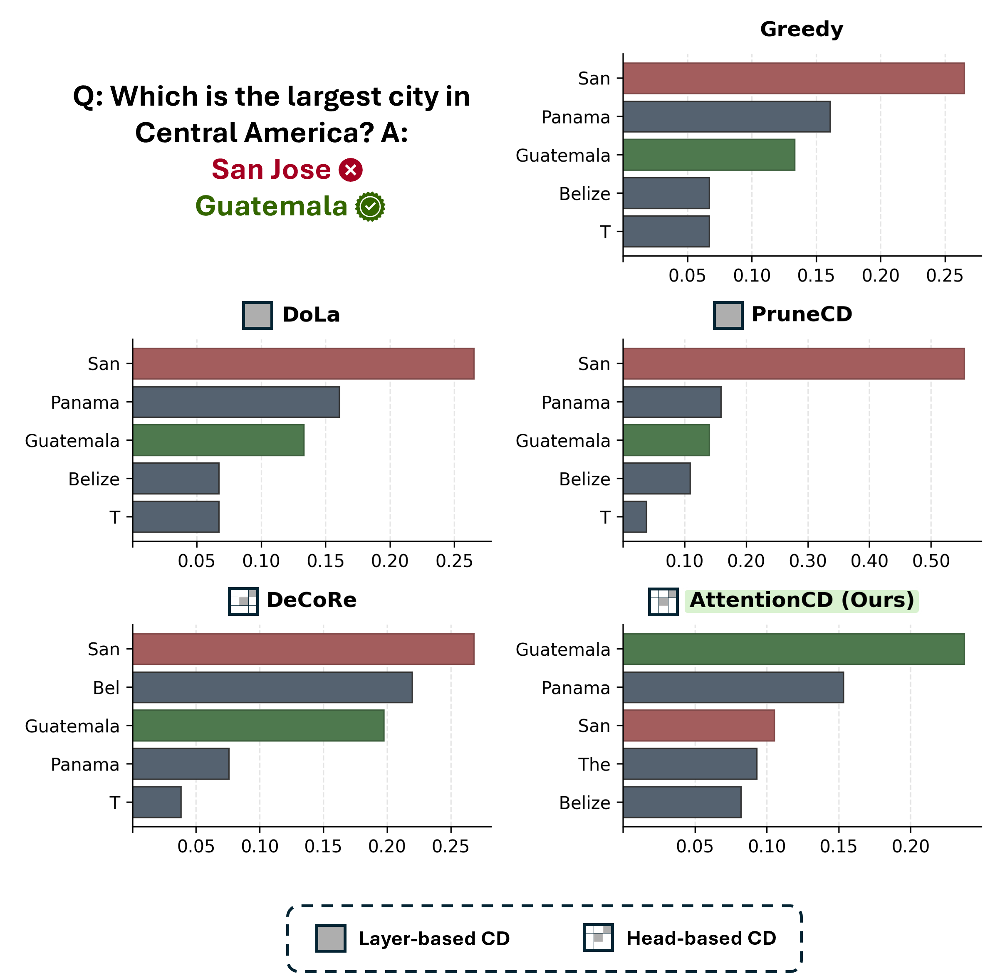

# **AttentionCD**: Reducing Factuality Hallucinations in Large Language Models using Task-specific Head-based Contrastive Decoding

  

Despite the tremendous volume of data they are trained on, Large Language Models (LLMs) can generate plausibly sounding but non-factual responses. These factually hallucinated responses reduce users’ trust in such models and hinder their adoption in safety-critical applications. Among the many training-free hallucination mitigation strategies proposed, contrastive decoding strategies have received wide attention. Most of the work in this direction explores how contrasting probability distributions from different decoder layers can help in reducing factuality hallucinations. This work, in contrast, investigates whether masking of attention heads can provide reliable contrastive signals. 

**AttentionCD** is a decoding strategy that masks task-specific attention heads to yield better contrastive signals to reduce factuality hallucinations in LLMs. Our approach shows competitive performance with the existing layer-based contrastive decoding strategies and offers an average performance improvement of over +20\% over greedy decoding across different tasks and models.

> We extend the code-base from the authors of PruneCD: https://github.com/hoeng4/PruneCD/tree/main. Thank you for your open-source contribution!

## 1. Task-specific Head Selection
As the first step, we discover task-specific special attention heads using task-specific indicators.

### 1.1. JSD Heads Selection 
We compute the Jensen-Shannon Divergence (JSD) between the final layer sequence probabilities of the base model and of the ablated model. A higher JSD indicates that the masked attention head results in a very divergent probability distribution compared to the base model. This makes it a suitable candidate for the undesired inference process helpful for contrastive decoding.

See JSD heads selection scripts [here](scripts/1_heads_selector/run_jsd_heads_selector.sh).

### 1.2. DS Heads Selection
We compute the downstream performance difference measured in terms of "Exact Match Delta" or "Accuracy Delta", etc., between the base model and the ablated model. If the performance difference is high, it indicates that the masked attention head has a significant contribution to the downstream task. This implies that masking this head can potentially result in an undesired inference process helpful for contrastive decoding. 

See DS heads selection scripts [here](scripts/1_heads_selector/run_ds_heads_selector.sh).

## 2. Hyper-parameter Sweep
For a fair evaluation, we run a two-fold cross-validation on all datasets with the different approaches. We use validation samples proportional to the number of test samples in the corresponding datasets. For reproducibility and transparency, we open-source the validation splits used for the hyper-parameter sweep.

See hyper-parameter sweep scripts [here](scripts/2_hyperparameter_sweep).

We list the hyper-parameters of AttentionCD and other CD techniques [here](Hyper-parameters.md).

## 3. Evaluation Runs

We obtain the best configuration from the hyper-parameter sweep and further use this configuration for evaluation on the test set of each dataset.

See evaluation run scripts [here](scripts/3_evaluation_run).